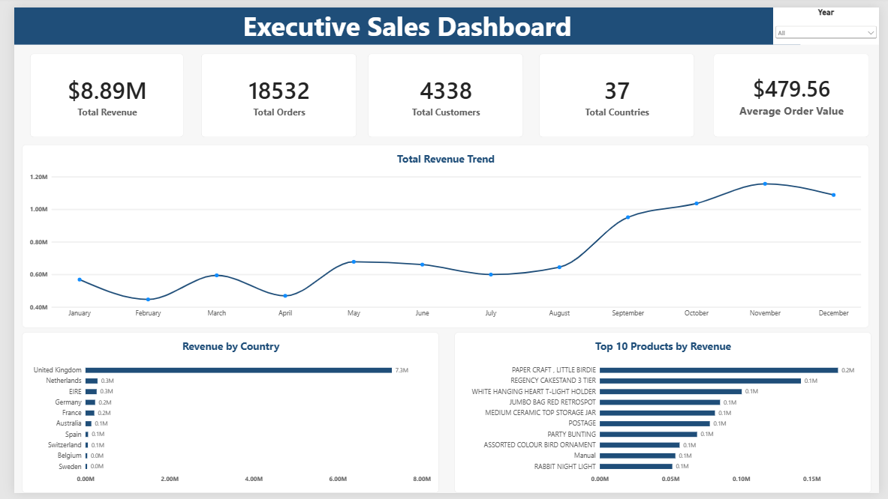
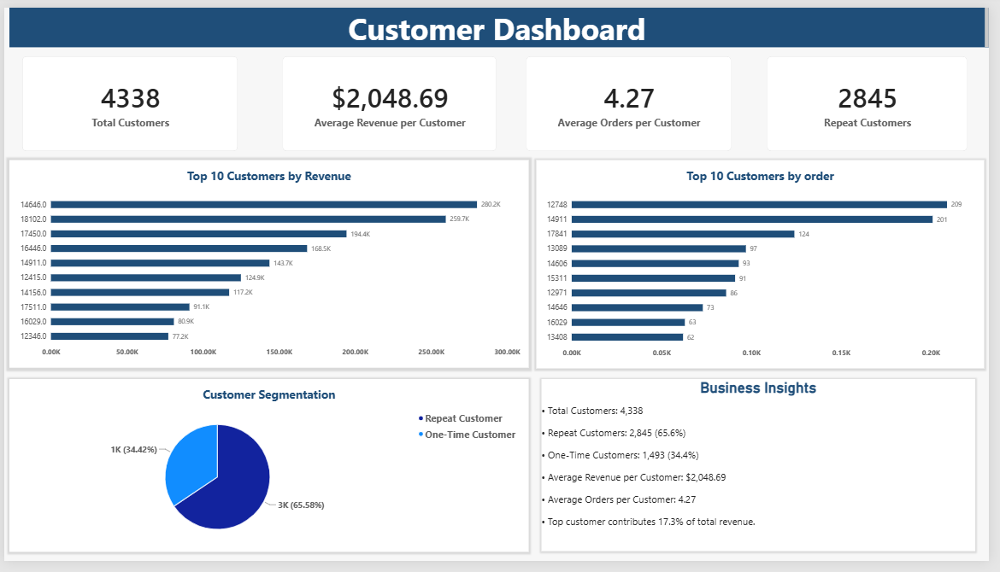
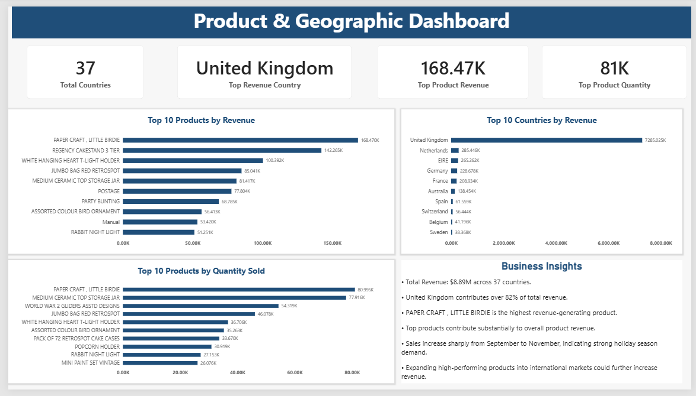

# Online Retail Sales Analytics

An end-to-end data analytics project using **Python, MySQL, and Power BI** to analyze retail sales performance, customer purchasing behavior, product performance, and geographic revenue distribution.

This project demonstrates the complete data analysis workflow, from cleaning raw transaction data to writing SQL queries and building interactive business dashboards.

## Table of Contents

- [Project Overview](#project-overview)
- [Business Objectives](#business-objectives)
- [Tools and Technologies](#tools-and-technologies)
- [Dataset](#dataset)
- [Project Workflow](#project-workflow)
- [Key Business Findings](#key-business-findings)
- [Power BI Dashboards](#power-bi-dashboards)
- [Repository Structure](#repository-structure)
- [How to Reproduce the Analysis](#how-to-reproduce-the-analysis)
- [SQL Analysis](#sql-analysis)
- [Skills Demonstrated](#skills-demonstrated)
- [Future Improvements](#future-improvements)
- [Author](#author)

## Project Overview

Retail businesses generate large amounts of transaction data, but raw data alone does not provide clear business insights.

The objective of this project is to transform retail transaction data into meaningful information that helps understand revenue trends, identify valuable customers, evaluate product performance, and compare sales across countries.

The project combines Python for data preparation and exploratory analysis, MySQL for business-focused queries, and Power BI for interactive reporting.

## Business Objectives

- Analyze overall retail sales performance using key performance indicators (KPIs).
- Identify monthly revenue trends and potential seasonal patterns.
- Identify top customers and evaluate repeat purchasing behavior.
- Rank products by revenue, quantity sold, and number of orders.
- Compare revenue, order volume, and customer distribution across countries.
- Present findings through interactive, business-oriented dashboards.

## Tools and Technologies

| Tool | Purpose |
|---|---|
| Python | Data cleaning and exploratory data analysis |
| Pandas | Data manipulation and transformation |
| NumPy | Numerical calculations |
| Matplotlib | Data visualization |
| Seaborn | Statistical visualization |
| MySQL | SQL-based business analysis |
| Power BI | Interactive dashboards and KPI reporting |
| Jupyter Notebook | Python analysis and documentation |
| GitHub | Project versioning and portfolio presentation |

## Dataset

This project uses the **Online Retail** dataset from the UCI Machine Learning Repository.

- **Dataset source:** [UCI Machine Learning Repository — Online Retail](https://archive.ics.uci.edu/dataset/352/online+retail)
- **Original file:** `Online Retail.xlsx`
- **Dataset period:** December 2010 to December 2011
- **Original creator:** Daqing Chen
- **License:** CC BY 4.0

The dataset contains retail transaction records, including invoice numbers, product codes, descriptions, quantities, invoice dates, unit prices, customer identifiers, and countries.

The original dataset is not stored in this repository. The Python notebook is used to clean and prepare the data and generate `online_retail_final.csv`.

## Project Workflow

### 1. Data Cleaning and Preparation — Python

- Loaded the original Excel dataset using Pandas.
- Inspected the dataset structure, data types, and missing values.
- Prepared the data for analysis using cleaning and validation steps.
- Created revenue and date-related fields for analytical use.
- Exported the processed dataset as `online_retail_final.csv`.

### 2. Exploratory Data Analysis — Python

- Analyzed revenue trends over time.
- Examined country-level sales performance.
- Identified high-performing products.
- Explored customer purchasing behavior.
- Used charts and statistical summaries to communicate patterns and findings.

### 3. Business Analysis — MySQL

Created SQL queries to analyze:

- Total records, revenue, orders, customers, and countries.
- Average order value and average revenue per customer.
- Top customers by revenue and order frequency.
- Repeat customers versus one-time customers.
- Top products by revenue and quantity sold.
- Product order frequency and revenue contribution.
- Top countries by revenue, orders, and customers.
- Revenue concentration by customer, product, and country.

### 4. Interactive Reporting — Power BI

Developed three dashboard pages to present key performance indicators, comparisons, trends, and business insights in an accessible format.

## Key Business Findings

The following are findings from the analyzed dataset and project SQL results. Values are approximate where indicated and may change if data cleaning or filtering rules change.

- **Revenue concentration:** The United Kingdom contributes approximately 82% of total revenue in the analyzed results, highlighting the importance of the UK market.
- **Customer retention:** Approximately 65.6% of customers are repeat customers, while 34.4% are one-time customers.
- **High-value customers:** The top 10 customers contribute approximately 17.3% of total revenue.
- **Product performance:** Comparing products by revenue, quantity sold, and order frequency helps distinguish high-value products from high-volume products.
- **Geographic performance:** Country-level comparisons reveal differences in revenue, order volume, and customer distribution.

These findings can support business decisions involving customer retention, product prioritization, and geographic sales strategy.

## Power BI Dashboards

### Page 1 — Executive Dashboard

Provides a high-level overview of retail sales performance.

**Includes:**
- KPI cards for key business metrics.
- Monthly revenue trend.
- Revenue by country.
- Top-performing products by revenue.



### Page 2 — Customer Dashboard

Focuses on customer value and purchasing behavior.

**Includes:**
- Customer-related KPIs.
- Top 10 customers by revenue.
- Top 10 customers by number of orders.
- Repeat versus one-time customer distribution.
- Customer-related business insights.



### Page 3 — Product and Geographic Dashboard

Examines product performance and country-level sales.

**Includes:**
- Product and geographic KPI cards.
- Top 10 products by revenue.
- Top 10 products by quantity sold.
- Top 10 countries by revenue.
- Product and geographic business insights.



## Repository Structure

```text
Online-Retail-Sales-Analytics/
│
├── README.md
│
├── Python/
│   └── Online_Retail_Analysis.ipynb
│
├── SQL/
│   └── online_retail_analysis.sql
│
├── PowerBI/
│   └── Online_Retail_Sales_Analytics.pbix
│
└── Screenshots/
    ├── Page1_Executive_Dashboard.png
    ├── Page2_Customer_Dashboard.png
    └── Page3_Product_Geographic_Dashboard.png
```

## How to Reproduce the Analysis

### Prerequisites

- Python and Jupyter Notebook.
- Python libraries: Pandas, NumPy, Matplotlib, and Seaborn.
- MySQL Server and MySQL Workbench.
- Power BI Desktop to open and explore the interactive report.

### Step 1 — Obtain the Dataset

Download the original `Online Retail.xlsx` file from the [UCI dataset page](https://archive.ics.uci.edu/dataset/352/online+retail).

### Step 2 — Run the Python Notebook

1. Open `Python/Online_Retail_Analysis.ipynb`.
2. Install any required dependencies that are not already available.
3. Update the dataset path to match your local file location.
4. Run the notebook cells in sequence.
5. Generate the cleaned file, `online_retail_final.csv`.

### Step 3 — Run the SQL Analysis

1. Open `SQL/online_retail_analysis.sql` in MySQL Workbench.
2. Create or select the appropriate database.
3. Update the CSV import path in the `LOAD DATA INFILE` statement to match your local file location.
4. Ensure the file is accessible to the MySQL server and that its import permissions are configured correctly.
5. Execute the script and review the resulting business metrics.

**Note:** The SQL script uses a local Windows file path from the development environment. It must be updated before running it on another computer.

### Step 4 — Explore the Power BI Dashboard

Open `PowerBI/Online_Retail_Sales_Analytics.pbix` using Power BI Desktop.

If prompted, update the data source path to your local cleaned dataset and refresh the report.

**Data availability:** The original dataset and generated cleaned CSV are not included in this repository. The Python notebook is the intended starting point for reproducing the cleaned data.

## SQL Analysis

The SQL script demonstrates practical business analysis techniques, including:

- Aggregate functions such as `SUM()`, `COUNT()`, and `AVG()`.
- Grouping and sorting using `GROUP BY` and `ORDER BY`.
- Filtering and ranking using `WHERE` and `LIMIT`.
- Conditional customer segmentation using `CASE`.
- Subqueries and common table expressions.
- Distinct order and customer calculations.
- Revenue contribution calculations.

## Skills Demonstrated

- Data cleaning and preprocessing
- Exploratory data analysis (EDA)
- Python and Pandas
- SQL querying and aggregation
- MySQL database workflows
- KPI development
- Customer analytics
- Product performance analysis
- Geographic sales analysis
- Data visualization
- Power BI dashboard development
- Business insight communication
- GitHub project documentation

## Future Improvements

Potential extensions to the project include:

- RFM-based customer segmentation.
- Customer cohort and retention analysis.
- Sales forecasting using time-series techniques.
- Product-level performance monitoring.
- Additional automated data-quality checks.

## Author

**Mayur Bende**

B.Tech CSE (AI & ML) | Aspiring Data Analyst

- **GitHub:** [mayurbende607](https://github.com/mayurbende607)
- **LinkedIn:** [mayur-bende](https://www.linkedin.com/in/mayur-bende/)

---

*This project was developed as a practical demonstration of data analytics, SQL, Python, and business intelligence skills.*
